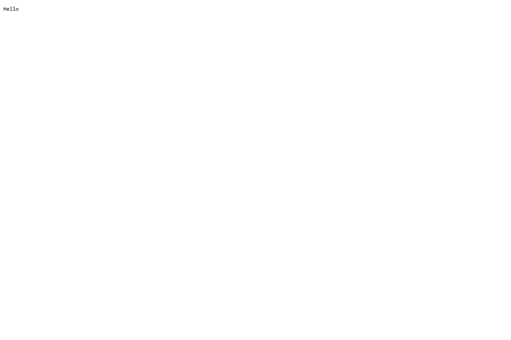
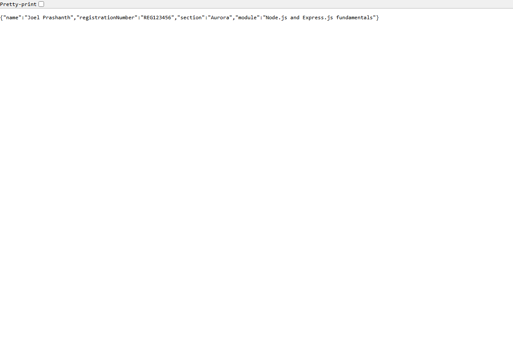
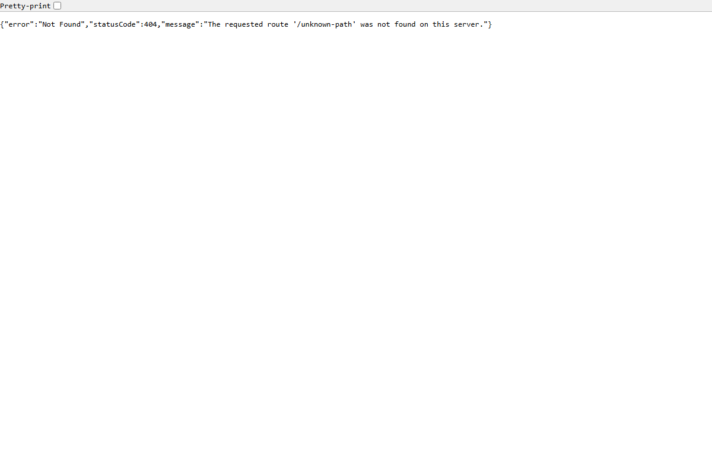

# Lab 1: Node.js and Express server

**Student Name:** Joel Prashanth • **Registration Number:** [Insert Registration Number] • **Section:** Aurora  
**Course:** Backend Development Fundamentals (Year II Term II) • **Faculty:** Joel Prashanth D  
**Live Link:** [Deployed Application Link (e.g. Render / Railway)](https://render.com) *(Update with your public URL if deployed, or see local run instructions below)*

---

## 1. Objective
Set up a Node.js project and build web servers:
1. Build a baseline web server using Node's built-in `http` module.
2. Refactor and scale the server using the **Express.js** framework.
3. Configure dedicated routes (`GET /`, `GET /about`, `GET /time`) and handle unknown routes with a proper HTTP 404 status code.
4. Log incoming requests along with HTTP response status codes.

---

## 2. Explanation of `package.json` Fields

When initializing a Node.js project using `npm init -y`, a `package.json` manifest is created. Below is an explanation of each field:

| Field | Purpose / Explanation |
|---|---|
| `name` | The unique name of the project or package (must be lowercase, URL-friendly). |
| `version` | Current version of the project following Semantic Versioning (`MAJOR.MINOR.PATCH`). |
| `description` | A brief textual summary describing the purpose of the application. |
| `main` | The entry point file of the application (e.g., `server.js`). Executed when the package is required or started. |
| `scripts` | A dictionary of shortcut commands that can be executed via `npm run <command>` (e.g., `npm start`, `npm run dev`). |
| `keywords` | Array of strings/tags that assist in searching and categorizing the project in package registries. |
| `author` | The name (and optionally email/website) of the package creator. |
| `license` | The open-source or proprietary licensing terms under which the code is released (e.g., `ISC`, `MIT`). |
| `dependencies` | A list of third-party packages required for the project to run in production (e.g., `express`). NPM automatically installs these when running `npm install`. |

---

## 3. How to Run

### Prerequisites
- [Node.js](https://nodejs.org/) (v18.x or v20.x+) installed.
- NPM (v9.x or v10.x+) installed.

### 1. Clone & Navigate to Lab 1
```bash
git clone <your-repository-url>
cd "Backend Labs/lab-01"
```

### 2. Environment Variables Configuration
Copy the provided `.env.example` file to `.env`:
```bash
cp .env.example .env
```
Available environment variables:
```env
PORT=3000
STUDENT_NAME=Joel Prashanth
STUDENT_REG_NO=REG123456
STUDENT_SECTION=Aurora
```

### 3. Install Dependencies
```bash
npm install
```
> Note: This installs Express and creates the `node_modules` directory and `package-lock.json`.

### 4. Running the Servers

- **Run the Vanilla Node.js HTTP Server (Task 3):**
  ```bash
  npm run start:http
  ```
  Access at: `http://localhost:3000/`

- **Run the Express Server (Tasks 4–7):**
  ```bash
  npm start
  ```
  Access at: `http://localhost:3000/`

- **Run in Development Mode (Auto-reload on file changes):**
  ```bash
  npm run dev
  ```

---

## 4. Endpoints & Scripts Table

### Available Scripts
| Command | Action |
|---|---|
| `npm start` | Launches the Express server (`node server.js`) |
| `npm run start:http` | Launches the baseline vanilla HTTP server (`node http-server.js`) |
| `npm run dev` | Runs the Express server in watch mode (`node --watch server.js`) |

### Express API Endpoints
| HTTP Method | Route | Status Code | Description | Response Type | Sample Output |
|---|---|---|---|---|---|
| `GET` | `/` | `200 OK` | Root endpoint displaying welcome text | Text (`text/plain`) | `"Welcome to the Express Server - Lab 1!"` |
| `GET` | `/about` | `200 OK` | Returns student details and module information | JSON (`application/json`) | `{"name":"Joel Prashanth","registrationNumber":"...","section":"Aurora"}` |
| `GET` | `/time` | `200 OK` | Returns current server date and time using `new Date()` | JSON (`application/json`) | `{"currentTime":"Sat Oct 31 2026 ...","iso":"...","epoch":...}` |
| `GET` / `*` | `/unknown-path` | `404 Not Found` | Catch-all handler for nonexistent paths | JSON (`application/json`) | `{"error":"Not Found","statusCode":404,"message":"..."}` |

---

## 5. Status Code Logging Verification

In accordance with Task 7, a custom Express middleware logs incoming requests alongside the HTTP response status code upon completion:

```
[2026-10-31T08:53:21.432Z] GET / -> Status: 200
[2026-10-31T08:53:25.100Z] GET /about -> Status: 200
[2026-10-31T08:53:28.450Z] GET /time -> Status: 200
[2026-10-31T08:53:32.180Z] GET /unknown-path -> Status: 404
```

---

## 6. Screenshots

### Task 3: Plain HTTP Server (`http.createServer`)
Replies with `"Hello"` and status `200 OK`:


### Task 5: Express Route `GET /`
Returns welcome text and status `200 OK`:


### Task 5: Express Route `GET /about`
Returns student name and section as JSON with status `200 OK`:


### Task 5: Express Route `GET /time`
Returns current date and time using JavaScript `new Date()` with status `200 OK`:


### Task 6: Express 404 Not Found Handler
Returns customized 404 JSON error for any unknown route:


---

## 7. Viva Questions & Answers

### Q1: What is the difference between `package.json` and `node_modules`?
- **`package.json`**:
  - A lightweight manifest metadata file tracked by version control (`git`).
  - Contains project configuration, scripts, metadata (name, version), and explicitly lists the package dependencies and versions required by the project.
- **`node_modules`**:
  - The actual directory containing the downloaded source code of all installed dependencies and their transitive dependencies.
  - Very large in size; should **never** be committed to Git. It can be fully regenerated at any time by running `npm install` based on `package.json` and `package-lock.json`.

### Q2: What does `app.listen()` do?
- In Express, `app.listen(port, [callback])` creates an underlying Node.js HTTP server instance (`http.createServer(app)`) and binds it to the specified TCP port and network interface.
- It begins listening for incoming TCP connections and dispatches incoming HTTP requests to Express middleware and route handlers.

### Q3: What do `request` (`req`) and `response` (`res`) represent?
- **`request` (`req`)**:
  - An object representing the incoming HTTP request sent by the client (browser, Postman, etc.).
  - Contains information such as the HTTP method (`GET`, `POST`), URL path, query parameters (`req.query`), route parameters (`req.params`), headers (`req.headers`), and request body (`req.body`).
- **`response` (`res`)**:
  - An object representing the HTTP response that the server sends back to the client.
  - Provides helper methods to set HTTP status codes (`res.status(200)`), set response headers (`res.set()`), and send back data (`res.send()`, `res.json()`, `res.sendFile()`).

---

## 8. Notes: Problems Faced and How You Solved Them

1. **Port Already in Use Error (`EADDRINUSE`):**
   - *Problem:* When transitioning from the plain `http.createServer` to the Express server, running both on port 3000 simultaneously caused an `EADDRINUSE: address already in use :::3000` exception.
   - *Solution:* Ensured the plain server process was terminated before starting Express, and made the port dynamic using `process.env.PORT || 3000`.

2. **Capturing Status Codes for Logging:**
   - *Problem:* In Express, when a middleware executes before a route handler, the final response status code has not yet been determined.
   - *Solution:* Used Node's event emitter pattern on the response stream (`res.on('finish', ...)`) within a custom middleware. This ensures the logger captures the exact final status code (`res.statusCode`) after route execution finishes.

3. **Handling Unknown Routes (404 Fallback):**
   - *Problem:* By default, unmatched routes in Express return an HTML 404 message (`Cannot GET /path`).
   - *Solution:* Placed a catch-all middleware (`app.use((req, res) => { ... })`) at the very end of the middleware stack (after all defined routes) to return a structured JSON response with a explicit 404 HTTP status code.
