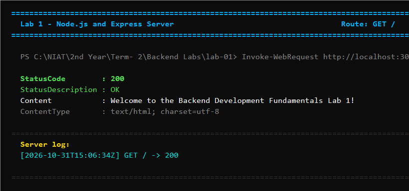
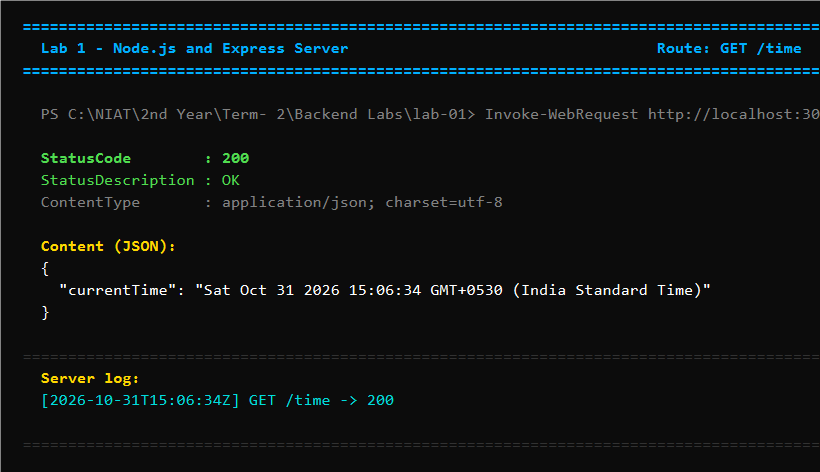
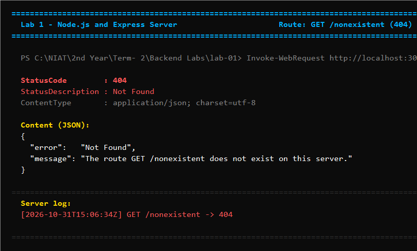

# Lab 1: Node.js and Express Server

**Name:** Joel Ramireddy  
**Registration Number:** *(your reg number)*  
**Section:** Year II – Term II  

**Live link:** Not applicable *(local server)*

---

## How to Run

### Prerequisites
- Node.js v18 or above installed

### Install dependencies
```bash
npm install
```

### Start the Express server (Tasks 4–7)
```bash
npm start
# or
node index.js
```

### Start the plain HTTP server (Task 3)
```bash
npm run start:http
# or
node http-server.js
```

The server listens on **port 3000** by default.  
No environment variables are required for this lab.

---

## Package.json Fields Explained (Task 1)

| Field | Purpose |
|---|---|
| `name` | The name of the project/package |
| `version` | Semantic version of the project (MAJOR.MINOR.PATCH) |
| `description` | Short description of what the project does |
| `main` | Entry point file Node.js loads when the package is required |
| `scripts` | Shortcut commands run via `npm run <name>` |
| `keywords` | Array of tags to help others discover the package on npm |
| `author` | Name of the person or organisation who created the project |
| `license` | The open-source licence under which the project is distributed |
| `dependencies` | Packages required at runtime (installed by `npm install`) |

---

## Endpoints

| Method | Path | Description | Status Code |
|---|---|---|---|
| GET | `/` | Returns a welcome text message | 200 |
| GET | `/about` | Returns JSON with developer name and section | 200 |
| GET | `/time` | Returns current date and time as JSON | 200 |
| `*` | any other path | Returns a 404 JSON error message | 404 |

---

## Screenshots

### GET /


### GET /about


### GET /time


### GET /unknown (404)


### Server console log


---

## Notes

- **Problems faced:** The PDF lab sheet used CID-encoded fonts which required a custom Node.js decoder to read.  
- The plain HTTP server (`http-server.js`) is kept separate from the Express server (`index.js`) to clearly show the difference between the two approaches (Tasks 3 vs 4).  
- The `node_modules/` folder and any `.env` files are excluded via `.gitignore`.
