# Lab 04: Registration, Login and JWT

## Student Details

- **Student Name:** Joel Ramireddy
- **Student Registration Number:** 252U1R5125
- **Class & Section:** AIDE 2B - 313
- **Study Level:** Undergraduate
- **Year & Term:** II Year – Term II
- **Subject:** Backend Development Fundamentals
- **Lab Number:** 04
- **Lab Title:** Registration, Login and JWT

---

## 1. Objective

The objective of this lab is to implement user registration and login functionality using Node.js, Express.js, SQLite, bcrypt and JSON Web Tokens (JWT).

The application allows new users to register with a username, name and password. It securely stores passwords by hashing them using bcrypt instead of storing plain-text passwords.

During login, the application verifies the user's credentials and generates a JSON Web Token (JWT) after successful authentication.

The main objectives are:

- Implement user registration.
- Prevent duplicate usernames.
- Store passwords securely using bcrypt hashing.
- Authenticate users during login.
- Generate JWT tokens using the jsonwebtoken package.
- Validate incorrect and incomplete user inputs.
- Test API endpoints using Postman.

## 2. Technologies Used

The following technologies and tools were used:

| Technology | Purpose |
|---|---|
| Node.js | JavaScript runtime environment |
| Express.js | Backend web framework |
| SQLite | Database management |
| sqlite | SQLite database interface |
| sqlite3 | SQLite database driver |
| bcrypt | Password hashing and verification |
| jsonwebtoken | JWT generation |
| Nodemon | Automatic server restarting during development |
| Postman | API testing |
| Visual Studio Code | Code editor |
| PowerShell | Terminal and command execution |

## 3. Project Structure

```text
lab-04/
│
├── .gitignore
├── app.js
├── database.js
├── package.json
├── package-lock.json
├── users.db                  # Generated automatically; not committed
│
└── screenshots/
    ├── 01-project-setup.png
    ├── 02-dependencies-installed.png
    ├── 03-users-table-created.png
    ├── 04-server-running.png
    ├── 05-registration-login-server.png
    ├── 06-register-success.png
    ├── 07-duplicate-registration.png
    ├── 08-login-success.png
    ├── 09-login-invalid-user.png
    ├── 10-login-wrong-password.png
    ├── 11-password-hash-verification.png
    ├── 12-jwt-token-decoded.png
    ├── 13-register-missing-fields.png
    └── 14-login-missing-fields.png
```

**Note:** The `users.db` file is generated automatically when the application runs and is excluded from GitHub using `.gitignore`. The `node_modules` directory is also excluded from version control. The screenshots are included in the repository as evidence of implementation and API testing.

## 4. Installation and Execution

### Prerequisites

Make sure the following software is installed:

- Node.js
- npm (Node Package Manager)
- Visual Studio Code (recommended)

### Step 1: Open the project directory

Open the terminal and navigate to the Lab 04 folder:

```powershell
cd lab-04
```

### Step 2: Install dependencies

Install all required project dependencies:

```powershell
npm install
```

### Step 3: Start the development server

To start the server with automatic restarting during development, run:

```powershell
npm run dev
```

Alternatively, start the application normally using:

```powershell
npm start
```

### Step 4: Access the application

The server runs locally at:

```text
http://localhost:3000
```

Expected terminal output:

```text
Users table created successfully
Server running at http://localhost:3000
```

The application uses Express JSON middleware (`express.json()`) to process incoming JSON request bodies.

### JWT Secret Configuration

For this lab exercise, the JWT secret is defined as a constant in `app.js`.

```javascript
const JWT_SECRET = "MY_SECRET_KEY";
```

For production applications, secret keys should be stored securely in environment variables rather than hardcoded in the source code.

### Live Deployment

**Deployment Status:** Not deployed.

This application is currently configured and tested in a local development environment using `http://localhost:3000`. A public deployment URL is not available for this lab submission.

## 5. Database Details

A SQLite database named `users.db` is used to store registered user information.

The application creates a table named `users` with the following columns:

| Column | Description |
|---|---|
| id | Unique user ID and primary key |
| username | Unique username of the user |
| name | Full name of the user |
| password | Hashed password |

### Database Table Creation

The users table is created using the following SQL structure:

```sql
CREATE TABLE IF NOT EXISTS users (
    id INTEGER PRIMARY KEY AUTOINCREMENT,
    username TEXT UNIQUE NOT NULL,
    name TEXT NOT NULL,
    password TEXT NOT NULL
);
```

### Password Security

Passwords are hashed using the bcrypt package before being inserted into the database.

The application uses:

```javascript
const hashedPassword = await bcrypt.hash(password, 10);
```

During login, the entered password is checked against the stored hash using:

```javascript
const isPasswordMatched = await bcrypt.compare(
    password,
    user.password
);
```

This ensures that the original plain-text password is not stored in the database.

## 6. API Endpoints

The application provides two main API endpoints.

| HTTP Method | Endpoint | Description |
|---|---|---|
| POST | `/register/` | Registers a new user |
| POST | `/login/` | Authenticates a user and generates a JWT token |

### 6.1 POST /register/

**Endpoint:**

```text
http://localhost:3000/register/
```

**Request Body:**

```json
{
    "username": "joel",
    "name": "Joel",
    "password": "Joel@123"
}
```

**Functionality:**

1. Accepts username, name and password.
2. Checks whether all required fields are provided.
3. Checks whether the username already exists.
4. Returns an error if the username is already registered.
5. Hashes the password using bcrypt.
6. Stores the new user details in the SQLite database.

**Successful Response:**

HTTP Status: `201 Created`

```json
{
    "message": "User registered successfully"
}
```

**Duplicate Username Response:**

HTTP Status: `400 Bad Request`

```json
{
    "error": "User already exists"
}
```

**Missing Fields Response:**

HTTP Status: `400 Bad Request`

```json
{
    "error": "Username, name and password are required"
}
```

### 6.2 POST /login/

**Endpoint:**

```text
http://localhost:3000/login/
```

**Request Body:**

```json
{
    "username": "joel",
    "password": "Joel@123"
}
```

**Functionality:**

1. Accepts username and password.
2. Checks whether the required fields are provided.
3. Searches for the user in the database.
4. Verifies the password using `bcrypt.compare()`.
5. Rejects invalid usernames or passwords.
6. Generates a JWT token using `jwt.sign()` after successful authentication.

**Successful Response:**

HTTP Status: `200 OK`

```json
{
    "jwt_token": "generated_jwt_token"
}
```

**Invalid Username Response:**

HTTP Status: `400 Bad Request`

```json
{
    "error": "Invalid user"
}
```

**Incorrect Password Response:**

HTTP Status: `400 Bad Request`

```json
{
    "error": "Invalid password"
}
```

**Missing Fields Response:**

HTTP Status: `400 Bad Request`

```json
{
    "error": "Username and password are required"
}
```

## 7. JWT Token Details

JSON Web Token (JWT) is used to represent authenticated user information.

The application generates a token after successful login using:

```javascript
const jwtToken = jwt.sign(
    { username: username },
    JWT_SECRET
);
```

Only the username is included in the JWT payload. The password is never included.

A JWT consists of three parts:

1. **Header:** Contains the signing algorithm and token type.
2. **Payload:** Contains the username and issued-at timestamp.
3. **Signature:** Used to verify the authenticity and integrity of the token.

The token was decoded using the JWT.io debugger to inspect the header and payload.

## 8. Screenshots and Results

The following screenshots demonstrate the implementation and testing of the Lab 04 application.

### 8.1 Project Setup

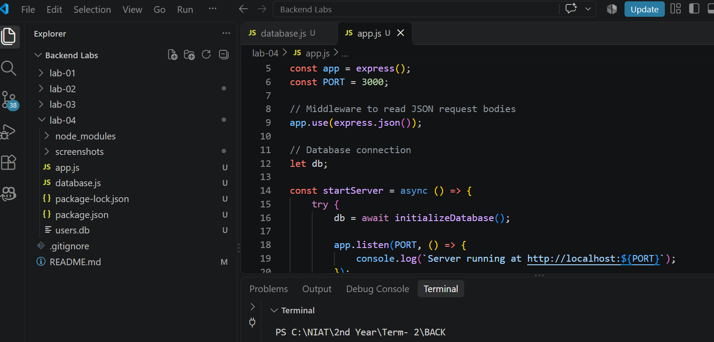

### 8.2 Dependencies Installed

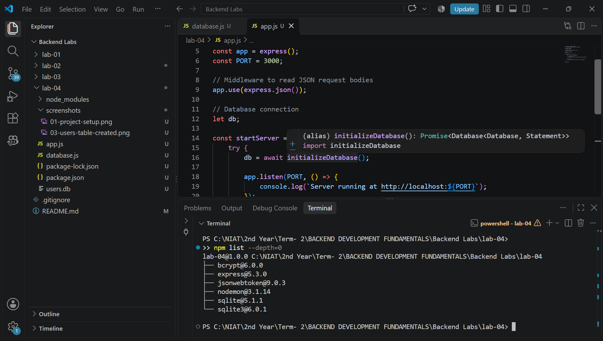

### 8.3 Users Table Created

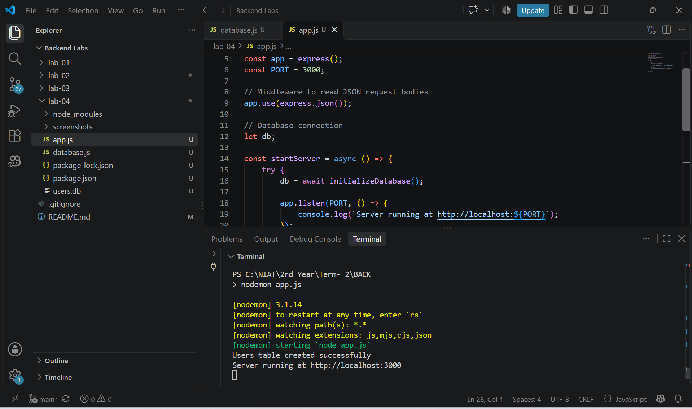

### 8.4 Server Running

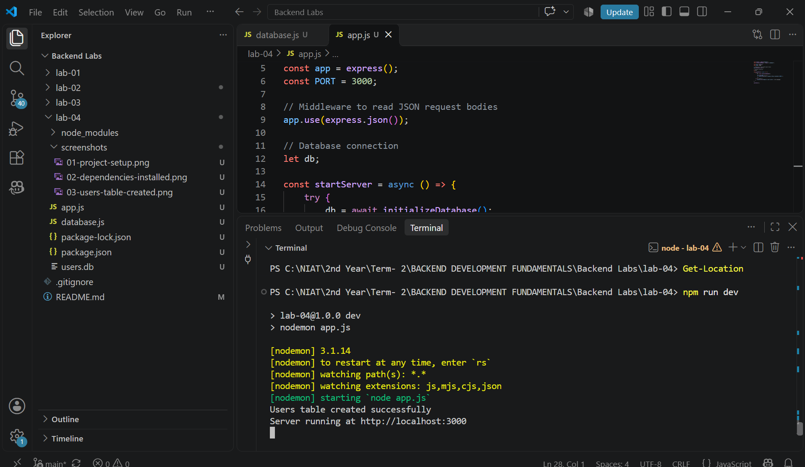

### 8.5 Registration and Login Server

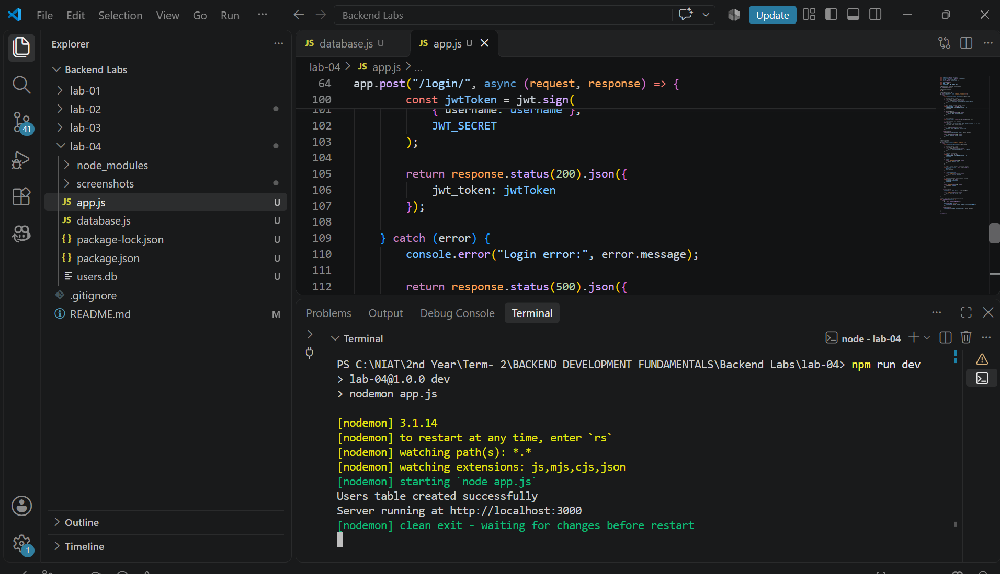

### 8.6 Successful User Registration

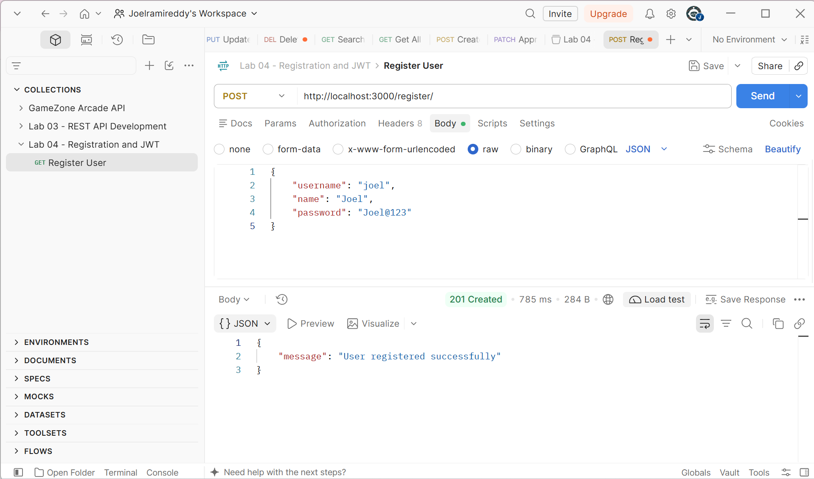

### 8.7 Duplicate Username Validation

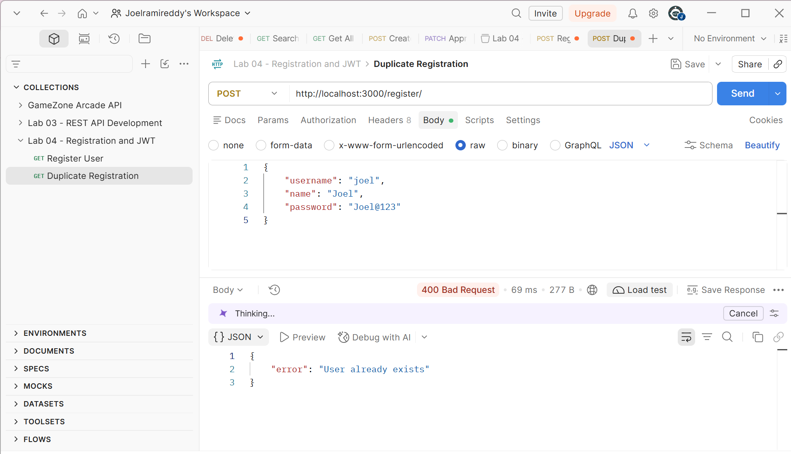

### 8.8 Successful Login with JWT Token

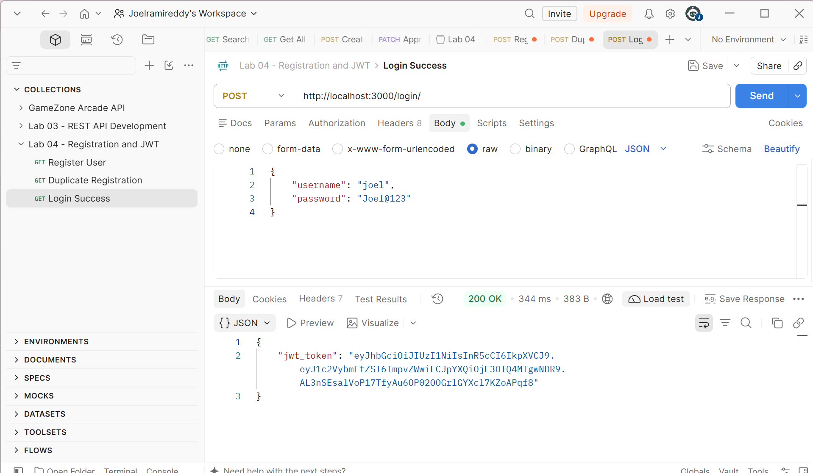

### 8.9 Login with Invalid Username

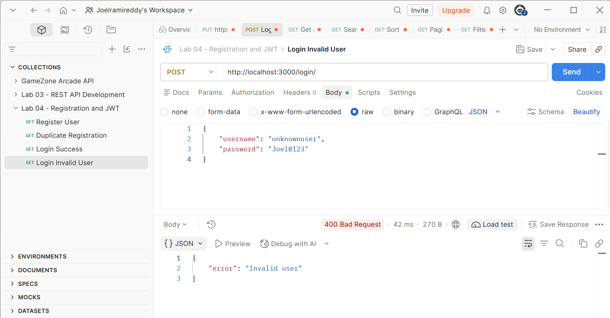

### 8.10 Login with Incorrect Password

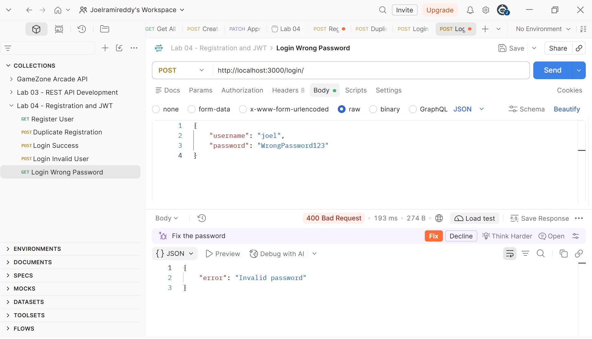

### 8.11 SQLite Database Showing Hashed Password

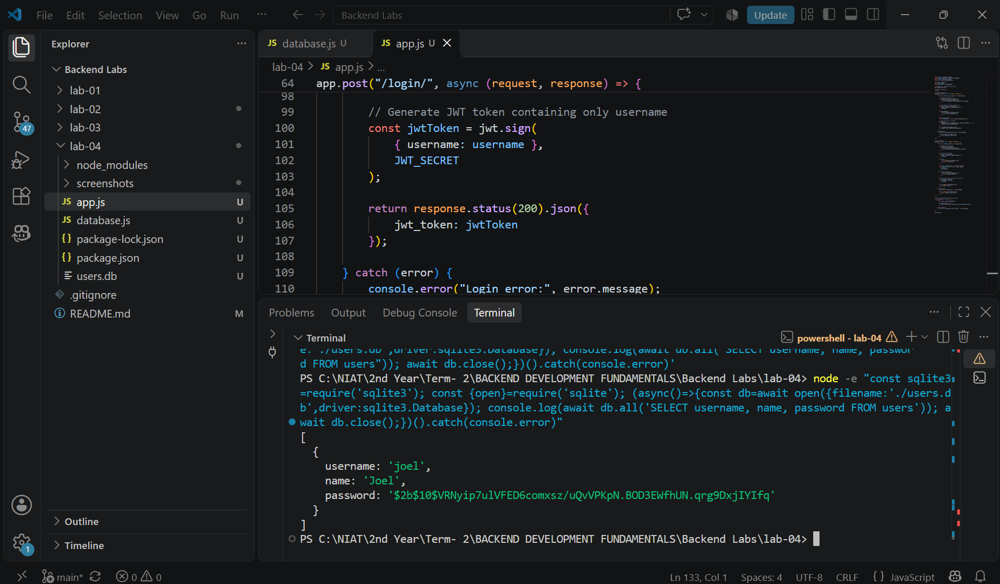

### 8.12 JWT Token Decoding

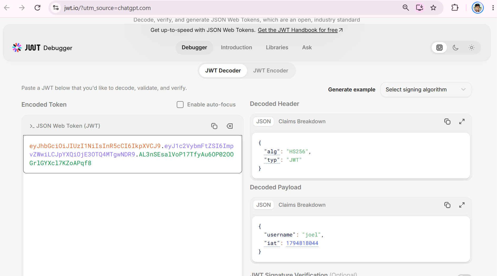

The decoded JWT payload contains the username and issued-at timestamp. The password is not included in the token.

### 8.13 Registration with Missing Fields

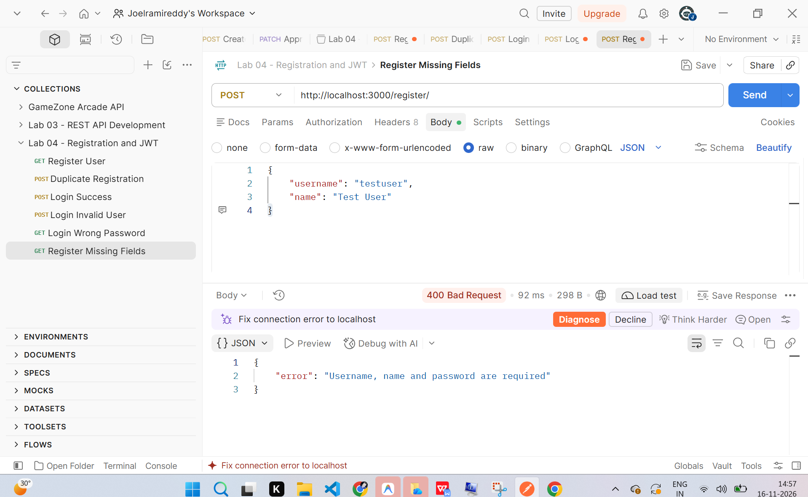

### 8.14 Login with Missing Fields

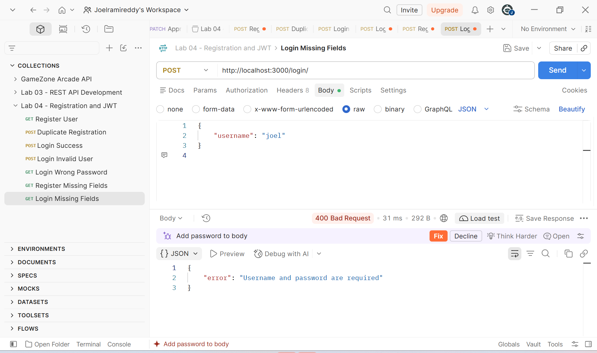

## 9. Problems Faced and Solutions

### 1. Database Initialization

**Problem:** The database needed to be initialized before processing API requests.

**Solution:** Created a separate `database.js` file to initialize the SQLite database and create the users table.

### 2. Duplicate Username

**Problem:** Multiple users should not be allowed to register with the same username.

**Solution:** Checked the existing username before inserting a new user and returned HTTP 400 when it already existed.

### 3. Password Security

**Problem:** Storing plain-text passwords is insecure.

**Solution:** Used bcrypt hashing with a salt-round value of 10 before storing passwords.

### 4. Login Validation

**Problem:** The application needed to verify the entered username and password.

**Solution:** Retrieved the user from SQLite and used `bcrypt.compare()` to verify the password.

### 5. JWT Generation

**Problem:** A token was required after successful authentication.

**Solution:** Used `jwt.sign()` from the jsonwebtoken package to generate a token containing only the username.

### 6. Postman Connection Error

**Problem:** Postman displayed a connection-refused error when the local server was not running.

**Solution:** Restarted the development server using `npm run dev` and kept it running while testing API requests.

### 7. PowerShell Command Quoting

**Problem:** A Node.js database inspection command produced a syntax error because of PowerShell quotation handling.

**Solution:** Corrected the command's quotation marks and successfully inspected the database to verify password hashing.

## 10. Conclusion

Successfully implemented a user registration and login system using Node.js, Express.js, SQLite, bcrypt and JSON Web Tokens.

The application supports user registration, duplicate username validation, secure password hashing, login authentication and JWT generation.

Postman was used to test successful and unsuccessful API requests. The SQLite database was also inspected to verify that passwords were stored as bcrypt hashes rather than plain text.

This lab provided practical experience in backend authentication, database operations, password security and JWT-based authentication.